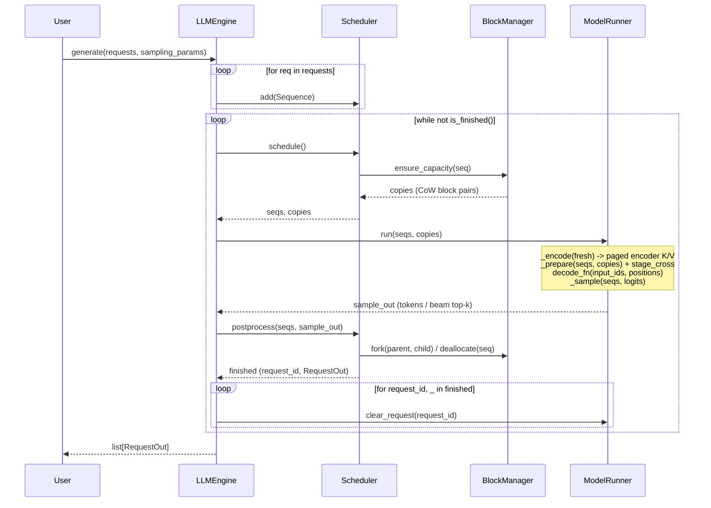

# fast-encdec

A small, readable CPU inference engine for **BART** and **Florence-2**, in the spirit of
[nano-vllm](https://github.com/GeeeekExplorer/nano-vllm).

## Key Features

* **Fast offline CPU inference** - paged KV cache, continuous batching, greedy and beam search
* **Readable codebase** - minimal PyTorch + [vllm-cpu-attention](https://github.com/ducviet00/vllm-cpu-attention) kernels
* **Two models, one engine** - BART for summarisation, Florence-2 for vision-language tasks
* **FP32 and BF16** - frozen `torch.compile` weight packing (oneDNN / ACL) + SIMD/AMX paged attention

## Installation

```bash
uv pip install torch torchvision setuptools --index-url https://download.pytorch.org/whl/cpu
uv pip install --no-build-isolation git+https://github.com/ducviet00/vllm-cpu-attention.git
uv pip install --no-build-isolation -e .
```

**On x86, use tcmalloc.** glibc malloc hands large freed buffers back to the OS, so every
Florence-2 vision forward page-faults them in again. On Xeon (c4-standard-8) tcmalloc makes
the vision stage ~1.9x faster and end-to-end throughput ~10% higher; on Axion (aarch64) it
makes no measurable difference.

```bash
sudo apt-get install -y libgoogle-perftools4t64   # older Ubuntu/Debian: libgoogle-perftools4
export LD_PRELOAD=/usr/lib/x86_64-linux-gnu/libtcmalloc.so.4
```

## Quick Start

See `examples/` for runnable scripts. `LLM` takes `dtype` (`torch.float32` or `torch.bfloat16`),
`max_num_seqs`, `compile` (default `True`) and `mm_cache_size`:

```python
from transformers import AutoTokenizer

from fastencdec import LLM, Request, SamplingParams

tokenizer = AutoTokenizer.from_pretrained("facebook/bart-large-cnn")
llm = LLM("facebook/bart-large-cnn")
request = Request(tokenizer("A car is parked in front of a building ...")["input_ids"])
outputs = llm.generate(request, SamplingParams(max_tokens=64, num_beams=4))
print(tokenizer.decode(outputs[0].completion_token_ids, skip_special_tokens=True))
```

`SamplingParams` fields you leave unset take the checkpoint's
`generation_config.json` values (beams, `no_repeat_ngram_size`, length penalty, ...),
as in `transformers`; set only what you want to override.

Florence-2 takes an image plus a task prompt, and the answer is parsed with the
processor:

```python
import torch
from PIL import Image
from transformers import AutoProcessor

from fastencdec import LLM, Request, SamplingParams

processor = AutoProcessor.from_pretrained("florence-community/Florence-2-base")
llm = LLM("florence-community/Florence-2-base", dtype=torch.bfloat16)
image = Image.open("car.jpg")
inputs = processor(text="<OD>", images=image, return_tensors="pt")
outputs = llm.generate(
    Request(inputs["input_ids"][0].tolist(), inputs["pixel_values"][0]),
    SamplingParams(max_tokens=256, num_beams=3),
)
text = processor.tokenizer.decode(outputs[0].completion_token_ids)
parsed = processor.post_process_generation(text, task="<OD>", image_size=image.size)
```

## How It Works

Reading order: `engine/sequence.py` -> `engine/block_manager.py` ->
`engine/scheduler.py` -> `engine/model_runner.py` -> `engine/llm_engine.py` ->
`layers/attention.py` -> `models/bart.py`. The step-by-step flow is in
[AGENTS.md section 4](AGENTS.md#4-how-a-step-works).



* **Paged KV cache.** Keys and values live in fixed blocks; beams share blocks and
  only copy one when they write into a shared block.
* **Continuous batching.** Requests join and leave the running batch freely.
* **No padding.** One token per sequence per step, and attention reads exactly the
  cached length of each sequence, so mixed lengths waste nothing.
* **Beam search** runs on the same cache, ranked by length-penalised score.
* **CPU attention.** Decoder self- and cross-attention call `vllm-cpu-attention`
  (`vllm_cpu_attn`) through opaque `torch.library.custom_op`s so the decoder,
  LM head, and encoder compile cleanly with Inductor weight freezing.

## Benchmark

Measured on GCP `c4a-standard-8` / `c4a-standard-16` (Arm Neoverse-V2, 8 / 16
physical cores) and `c4-standard-8` / `c4-standard-16` (Intel Xeon 8581C,
**4 / 8** physical cores, AMX) with `torch 2.15.0+cpu`, `transformers 5.22.2` and
`vllm-cpu-attn 0.1.0`, bf16. Both backends on the Xeon boxes run with tcmalloc
(`LD_PRELOAD`, see Installation). Wall times are not like-for-like across Arm and
x86: at the same vCPU count the Xeon box has half the physical cores.

**Continuous batching** (`benchmarks/continuous_batching.py`): 128 Florence-2-base
requests (32 COCO images x `<OD>`, `<OCR>`, `<DETAILED_CAPTION>`,
`<REFERRING_EXPRESSION_SEGMENTATION>`, shuffled), up to 512 tokens each.
fast-encdec keeps `--max-num-seq` requests in flight and refills a slot as soon as a
request finishes; its multimodal cache (on by default, cleared before each run)
runs the vision encoder once per image: 32 misses, 96 hits. HF runs padded batches
of 8 and encodes every image, and 64-71% of its decoded positions are padding.
HF takes a long time, so it is only benchmarked at batch size 8 for now; every
speedup is fast-encdec over HF batch 8 on the same machine, by wall time. Cells are
wall time and generated tokens/s. Greedy: one timed run after 3 warmup runs;
beams=4: best of 2 timed runs after 1 warmup run.

With beam search every request runs as 4 sequences, so `max num seq` 64 with
beams=4 decodes 64 x 4 = 256 sequences per step, not 64 as with greedy.

Greedy:

| max num seq | c4a-standard-8 | c4-standard-8 | c4a-standard-16 | c4-standard-16 |
|---|---:|---:|---:|---:|
| 8 | 26.1 s, 509 tok/s (**4.26x**) | 20.7 s, 649 tok/s (**5.45x**) | 18.3 s, 723 tok/s (**4.50x**) | 14.4 s, 954 tok/s (**4.86x**) |
| 16 | 23.9 s, 554 tok/s (**4.64x**) | 18.9 s, 719 tok/s (**5.96x**) | 15.6 s, 852 tok/s (**5.28x**) | 12.5 s, 1091 tok/s (**5.60x**) |
| 32 | 22.4 s, 591 tok/s (**4.95x**) | 17.6 s, 775 tok/s (**6.40x**) | 14.0 s, 946 tok/s (**5.87x**) | 10.5 s, 1287 tok/s (**6.65x**) |
| 64 | – | – | 13.5 s, 978 tok/s (**6.07x**) | 10.0 s, 1349 tok/s (**6.99x**) |
| HF, batch 8 | 110.9 s, 123 tok/s | 112.7 s, 119 tok/s | 82.2 s, 166 tok/s | 69.8 s, 192 tok/s |

Beams=4 (sequences in flight = 4 x max num seq):

| max num seq | c4a-standard-8 | c4-standard-8 | c4a-standard-16 | c4-standard-16 |
|---|---:|---:|---:|---:|
| 8 | 46.8 s, 392 tok/s (**5.29x**) | 40.7 s, 477 tok/s (**9.37x**) | 34.0 s, 540 tok/s (**5.88x**) | 26.6 s, 736 tok/s (**9.60x**) |
| 16 | 41.2 s, 445 tok/s (**6.01x**) | 35.6 s, 543 tok/s (**10.70x**) | 26.1 s, 702 tok/s (**7.66x**) | 21.6 s, 888 tok/s (**11.84x**) |
| 32 | 37.7 s, 486 tok/s (**6.57x**) | 33.4 s, 571 tok/s (**11.40x**) | 23.1 s, 792 tok/s (**8.64x**) | 20.0 s, 951 tok/s (**12.79x**) |
| 64 | – | – | 21.4 s, 855 tok/s (**9.32x**) | 19.0 s, 1003 tok/s (**13.49x**) |
| HF, batch 8 | 247.5 s, 80 tok/s | 381.1 s, 51 tok/s | 199.8 s, 100 tok/s | 255.7 s, 75 tok/s |

**Per stage** (`benchmarks/stage_latency.py`): batch 8; Florence-2-base with
`<DETAILED_CAPTION>` (590 encoder tokens), BART-large-cnn with 512 encoder tokens.
The multimodal cache is off here so the vision stage runs every call.
The decode step is averaged over 128 steps with EOS suppressed. 8-vCPU boxes;
cells are fast-encdec / HF (speedup).

| stage | c4a-standard-8 | c4-standard-8 |
|---|---:|---:|
| Florence-2 vision | 2231 / 2233 ms (1.00x) | 1529 / 2596 ms (1.70x) |
| Florence-2 encode | 267 / 262 ms (0.98x) | 160 / 182 ms (1.13x) |
| Florence-2 decode step, greedy | 6.22 / 11.41 ms (1.83x) | 8.02 / 13.08 ms (1.63x) |
| Florence-2 decode step, beams=4 | 12.65 / 25.40 ms (2.01x) | 15.58 / 50.28 ms (3.23x) |
| BART encode | 710 / 724 ms (1.02x) | 386 / 418 ms (1.08x) |
| BART decode step, greedy | 13.36 / 24.39 ms (1.83x) | 18.26 / 28.08 ms (1.54x) |
| BART decode step, beams=4 | 27.05 / 54.47 ms (2.01x) | 33.72 / 103.74 ms (3.08x) |

## Tests & Benchmarks

```bash
PYTHONPATH=. python tests/test_parity.py            # vs transformers, tiny random BART
PYTHONPATH=. python tests/test_florence2.py         # vs transformers, tiny random Florence-2
PYTHONPATH=. python tests/test_beam.py              # beam candidate selection
PYTHONPATH=. python tests/test_logits_processor.py  # LogitsProcessor parity vs transformers
PYTHONPATH=. python tests/test_engine.py            # lifetime, cache budgets, validation, loading
PYTHONPATH=. python tests/test_benchmarks.py        # benchmark helpers
PYTHONPATH=. python tests/verify_parity.py          # real checkpoints (BART + Florence-2)

# one backend per run; run with --backend fast and --backend hf and compare
PYTHONPATH=. python benchmarks/stage_latency.py --backend fast         # Florence-2: vision / encode / decode-step ms
PYTHONPATH=. python benchmarks/stage_latency.py --backend fast --model facebook/bart-large-cnn
PYTHONPATH=. python benchmarks/continuous_batching.py --backend fast   # 128 mixed Florence-2 requests, 8 in flight (hf: padded batches of 8)
```
