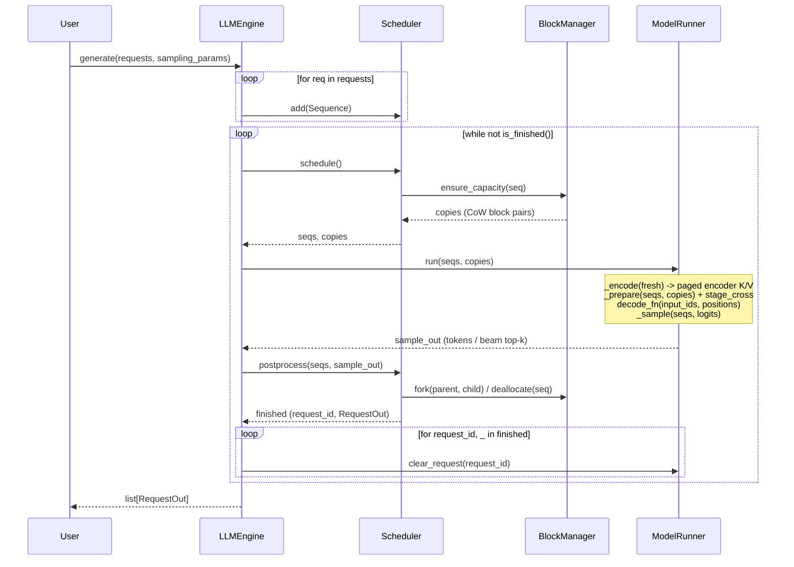

<p align="center">
  <picture>
    
  </picture>
</p>

A small CPU inference engine for **BART** and **Florence-2**. The code is easy to read, as in
[nano-vllm](https://github.com/GeeeekExplorer/nano-vllm).

---

## Features

* **Fast offline CPU inference**: paged KV cache, continuous batching, greedy search and beam search.
* **Small codebase**: PyTorch and the [vllm-cpu-attention](https://github.com/ducviet00/vllm-cpu-attention) kernels only.
* **Two models, one engine**: BART for summaries, Florence-2 for vision-language tasks.
* **FP32 and BF16**: `torch.compile` with frozen weights (oneDNN / ACL) and SIMD/AMX paged attention.

## Installation

Install into your own project's venv (Python >= 3.12). CPU PyTorch and `vllm-cpu-attn`
go first, because `vllm-cpu-attn` builds against the installed torch:

```bash
uv pip install torch==2.15.0 torchvision setuptools --index-url https://download.pytorch.org/whl/cpu
uv pip install --no-build-isolation git+https://github.com/ducviet00/vllm-cpu-attention.git
uv pip install --no-build-isolation git+https://github.com/ducviet00/vflorence.git
```

Then `from vflorence import LLM, Request, SamplingParams`. To ship a wheel instead, run
`uv build --wheel --no-build-isolation` here and install `dist/vflorence-*.whl` in place of
the last line. The first two lines are still needed on the target machine: the wheel only
names `vllm-cpu-attn` and does not know to build it from git.
To work on vflorence itself, replace the last line with `uv pip install --no-build-isolation -e .`
in a clone.

**On x86, use tcmalloc.** glibc malloc gives large freed buffers back to the OS. Thus each
Florence-2 vision forward causes the same page faults again. On Xeon (`c4-standard-8`),
tcmalloc makes the vision stage ~1.9x faster and increases end-to-end throughput by ~10%.
On Axion (aarch64), there is no measurable difference.

```bash
sudo apt-get install -y libgoogle-perftools4t64   # older Ubuntu/Debian: libgoogle-perftools4
export LD_PRELOAD=/usr/lib/x86_64-linux-gnu/libtcmalloc.so.4
```

## Quick Start

The `examples/` directory contains scripts that you can run. `LLM` has these parameters:
`dtype` (`torch.float32` or `torch.bfloat16`), `max_num_seqs`, `compile` (default `True`)
and `mm_cache_size`.

```python
from transformers import AutoTokenizer

from vflorence import LLM, Request, SamplingParams

tokenizer = AutoTokenizer.from_pretrained("facebook/bart-large-cnn")
llm = LLM("facebook/bart-large-cnn")
request = Request(tokenizer("A car is parked in front of a building ...")["input_ids"])
outputs = llm.generate(request, SamplingParams(max_tokens=64, num_beams=4))
print(tokenizer.decode(outputs[0].completion_token_ids, skip_special_tokens=True))
```

If you do not set a `SamplingParams` field, the engine uses the value from the checkpoint's
`generation_config.json` (beams, `no_repeat_ngram_size`, length penalty, ...), as
`transformers` does. Set only the fields that you want to change.

Florence-2 uses an image and a task prompt. Use the processor to parse the answer:

```python
import torch
from PIL import Image
from transformers import AutoProcessor

from vflorence import LLM, Request, SamplingParams

processor = AutoProcessor.from_pretrained("florence-community/Florence-2-base")
llm = LLM(
    "florence-community/Florence-2-base", dtype=torch.bfloat16, max_decoder_len=256
)
image = Image.open("car.jpg")
inputs = processor(text="<OD>", images=image, return_tensors="pt")
outputs = llm.generate(
    Request(inputs["input_ids"][0].tolist(), inputs["pixel_values"][0]),
    SamplingParams(max_tokens=256, num_beams=3),
)
text = processor.tokenizer.decode(outputs[0].completion_token_ids)
parsed = processor.post_process_generation(text, task="<OD>", image_size=image.size)
```

## How It Works



* **Paged KV cache.** Keys and values are in blocks of a fixed size. Beams share blocks.
  A beam copies a shared block only before it writes into that block.
* **Continuous batching.** A request can go into or out of the batch at each step.
* **No padding.** Each step feeds one token for each sequence. Attention reads only the
  cached length of each sequence. Thus mixed lengths do not waste compute.
* **Beam search.** Beam search uses the same cache. The engine ranks the beams by their
  score with the length penalty.
* **CPU attention.** Decoder self-attention and cross-attention call `vllm-cpu-attention`
  (`vllm_cpu_attn`) through opaque `torch.library.custom_op`s. Thus Inductor can compile
  the decoder, the LM head and the encoder with frozen weights.

## Benchmark

Machines (GCP):

* `c4a-standard-8` / `c4a-standard-16`: Arm Neoverse-V2, 8 / 16 physical cores.
* `c4-standard-8` / `c4-standard-16`: Intel Xeon 8581C, **4 / 8** physical cores, AMX.

Software: `torch 2.15.0+cpu`, `transformers 5.22.2`, `vllm-cpu-attn 0.1.0`, bf16.
On the Xeon machines, the two backends use tcmalloc (`LD_PRELOAD`, see Installation).

Do not compare wall times between Arm and x86 directly. For the same vCPU count, the Xeon
machine has half the physical cores.

### Continuous batching

Script: `benchmarks/continuous_batching.py`.

* Workload: 128 Florence-2 requests, a maximum of 512 tokens each. The requests are
  32 COCO images x `<OD>`, `<CAPTION>`, `<DETAILED_CAPTION>`,
  `<REFERRING_EXPRESSION_SEGMENTATION>`, in random order.
* The two backends use the checkpoint's generation config (`no_repeat_ngram_size=3`, ...).
* vflorence keeps `--max-num-req` requests in the batch. When a request is complete,
  a new request immediately takes its slot.
* The multimodal cache of vflorence is on (the default) and is cleared before each run.
  Thus the vision encoder runs one time for each image: 32 misses, 96 hits.
* HF runs padded batches of the same size and encodes the image of each request.
  68-81% of its decoded positions are padding.
* With beam search, each request runs as 4 sequences. Thus 64 requests with beams=4
  decode 256 sequences in each step.

How to read the cells:

* Line 1: vflorence / HF wall time (**speedup**), the median of 3 timed runs after 1 warmup.
* Line 2: vflorence / HF generated tokens for each second of wall time.
* HF OOM: the kernel stopped the process on the 30 GB `c4-standard-8`.
* The vflorence Florence-2-large numbers on `c4-standard-16` are from 2026-11-12. They
  include the per-image vision tower and the max-autotune decode graph. All other cells
  are older than these two changes.

Florence-2-base, greedy:

| max num req | c4a-standard-8 | c4-standard-8 | c4a-standard-16 | c4-standard-16 |
|---|---:|---:|---:|---:|
| 8 | 27.4 s / 113.6 s (**4.14x**)<br>493 / 118 tok/s | 26.2 s / 128.8 s (**4.91x**)<br>502 / 106 tok/s | 20.7 s / 90.9 s (**4.39x**)<br>644 / 148 tok/s | 15.2 s / 69.5 s (**4.57x**)<br>886 / 196 tok/s |
| 16 | 25.0 s / 97.5 s (**3.89x**)<br>539 / 138 tok/s | 21.9 s / 113.4 s (**5.17x**)<br>610 / 120 tok/s | 17.7 s / 73.6 s (**4.15x**)<br>768 / 184 tok/s | 12.5 s / 65.8 s (**5.27x**)<br>1071 / 207 tok/s |
| 32 | 22.7 s / 89.8 s (**3.95x**)<br>593 / 150 tok/s | 20.1 s / 117.0 s (**5.81x**)<br>670 / 116 tok/s | 15.5 s / 63.2 s (**4.07x**)<br>868 / 213 tok/s | 10.9 s / 69.6 s (**6.37x**)<br>1216 / 195 tok/s |
| 64 | 23.2 s / 78.9 s (**3.40x**)<br>582 / 170 tok/s | 19.3 s / 108.4 s (**5.63x**)<br>694 / 125 tok/s | 15.3 s / 50.5 s (**3.30x**)<br>883 / 266 tok/s | 10.3 s / 62.1 s (**6.02x**)<br>1291 / 218 tok/s |

Florence-2-base, beams=4:

| max num req | c4a-standard-8 | c4-standard-8 | c4a-standard-16 | c4-standard-16 |
|---|---:|---:|---:|---:|
| 8 | 41.6 s / 226.6 s (**5.45x**)<br>328 / 61 tok/s | 37.0 s / 357.8 s (**9.66x**)<br>372 / 38 tok/s | 31.2 s / 190.2 s (**6.09x**)<br>439 / 73 tok/s | 21.3 s / 230.4 s (**10.80x**)<br>655 / 58 tok/s |
| 16 | 35.9 s / 207.2 s (**5.76x**)<br>379 / 66 tok/s | 32.3 s / 386.6 s (**11.95x**)<br>425 / 35 tok/s | 25.0 s / 166.9 s (**6.68x**)<br>543 / 81 tok/s | 18.3 s / 237.2 s (**12.93x**)<br>743 / 57 tok/s |
| 32 | 33.5 s / 219.0 s (**6.54x**)<br>407 / 62 tok/s | 30.3 s / 441.9 s (**14.57x**)<br>451 / 31 tok/s | 22.8 s / 174.1 s (**7.64x**)<br>597 / 78 tok/s | 17.2 s / 278.6 s (**16.23x**)<br>786 / 49 tok/s |
| 64 | 32.5 s / 195.6 s (**6.01x**)<br>419 / 70 tok/s | 29.2 s / 435.4 s (**14.93x**)<br>471 / 31 tok/s | 21.5 s / 138.7 s (**6.44x**)<br>629 / 98 tok/s | 16.4 s / 260.6 s (**15.91x**)<br>835 / 52 tok/s |

Florence-2-large, greedy:

| max num req | c4a-standard-8 | c4-standard-8 | c4a-standard-16 | c4-standard-16 |
|---|---:|---:|---:|---:|
| 8 | 72.1 s / 292.8 s (**4.06x**)<br>184 / 45 tok/s | 64.1 s / 276.4 s (**4.31x**)<br>206 / 48 tok/s | 48.0 s / 195.5 s (**4.08x**)<br>276 / 68 tok/s | 29.9 s / 151.5 s (**5.07x**)<br>444 / 86 tok/s |
| 16 | 69.2 s / 285.0 s (**4.12x**)<br>197 / 46 tok/s | 55.0 s / 261.8 s (**4.76x**)<br>241 / 50 tok/s | 41.6 s / 169.3 s (**4.07x**)<br>320 / 78 tok/s | 25.5 s / 139.8 s (**5.49x**)<br>521 / 95 tok/s |
| 32 | 67.9 s / 267.6 s (**3.94x**)<br>196 / 50 tok/s | 50.4 s / 270.3 s (**5.36x**)<br>259 / 49 tok/s | 38.6 s / 148.4 s (**3.84x**)<br>344 / 90 tok/s | 23.2 s / 143.2 s (**6.17x**)<br>552 / 93 tok/s |
| 64 | 69.5 s / 250.5 s (**3.61x**)<br>191 / 53 tok/s | 48.5 s / HF OOM<br>271 / – tok/s | 38.1 s / 129.9 s (**3.41x**)<br>349 / 102 tok/s | 22.3 s / 135.1 s (**6.05x**)<br>584 / 97 tok/s |

Florence-2-large, beams=4:

| max num req | c4a-standard-8 | c4-standard-8 | c4a-standard-16 | c4-standard-16 |
|---|---:|---:|---:|---:|
| 8 | 107.2 s / 488.1 s (**4.55x**)<br>121 / 26 tok/s | 84.5 s / 746.8 s (**8.84x**)<br>149 / 17 tok/s | 63.9 s / 354.9 s (**5.56x**)<br>201 / 36 tok/s | 40.9 s / 468.6 s (**11.46x**)<br>308 / 28 tok/s |
| 16 | 93.9 s / 499.5 s (**5.32x**)<br>136 / 25 tok/s | 76.9 s / 842.8 s (**10.96x**)<br>166 / 16 tok/s | 54.8 s / 336.3 s (**6.14x**)<br>234 / 38 tok/s | 37.5 s / 514.8 s (**13.71x**)<br>336 / 25 tok/s |
| 32 | 87.0 s / 558.9 s (**6.42x**)<br>148 / 23 tok/s | 73.1 s / 1038.1 s (**14.20x**)<br>173 / 12 tok/s | 51.5 s / 352.0 s (**6.83x**)<br>249 / 36 tok/s | 35.3 s / 620.9 s (**17.61x**)<br>362 / 20 tok/s |
| 64 | 85.6 s / 532.6 s (**6.22x**)<br>150 / 24 tok/s | 73.1 s / HF OOM<br>173 / – tok/s | 50.6 s / 341.9 s (**6.76x**)<br>254 / 37 tok/s | 34.6 s / 629.1 s (**18.16x**)<br>371 / 20 tok/s |

### Per stage

Script: `benchmarks/stage_latency.py`.

* Batch size: 8.
* Florence-2-base uses `<DETAILED_CAPTION>` (590 encoder tokens). BART-large-cnn uses
  512 encoder tokens.
* The multimodal cache is off. Thus the vision stage runs on each call.
* The decode step is the average of 128 steps with EOS suppressed.
* Each number is the median of 3 timed runs after 1 warmup.
* Each cell shows vflorence / HF (speedup).

| stage | c4a-standard-8 | c4-standard-8 | c4a-standard-16 | c4-standard-16 |
|---|---:|---:|---:|---:|
| Florence-2 vision | 2240 / 2412 ms (1.08x) | 1505 / 2582 ms (1.72x) | 1166 / 1176 ms (1.01x) | 703 / 1348 ms (1.92x) |
| Florence-2 encode | 268 / 280 ms (1.04x) | 160 / 185 ms (1.15x) | 144 / 145 ms (1.01x) | 81.1 / 90.1 ms (1.11x) |
| Florence-2 decode step, greedy | 6.79 / 11.64 ms (1.71x) | 7.69 / 13.14 ms (1.71x) | 6.16 / 9.93 ms (1.61x) | 4.52 / 7.31 ms (1.62x) |
| Florence-2 decode step, beams=4 | 13.0 / 25.3 ms (1.95x) | 13.4 / 45.4 ms (3.37x) | 11.6 / 22.0 ms (1.90x) | 7.36 / 28.45 ms (3.87x) |
| BART encode | 731 / 745 ms (1.02x) | 379 / 422 ms (1.11x) | 375 / 376 ms (1.00x) | 192 / 217 ms (1.13x) |
| BART decode step, greedy | 13.4 / 25.2 ms (1.88x) | 18.9 / 28.5 ms (1.50x) | 11.4 / 20.9 ms (1.83x) | 9.88 / 16.18 ms (1.64x) |
| BART decode step, beams=4 | 28.0 / 54.6 ms (1.95x) | 31.4 / 91.0 ms (2.90x) | 19.6 / 45.0 ms (2.30x) | 17.5 / 58.5 ms (3.34x) |

## Tests & Benchmarks

```bash
PYTHONPATH=. python tests/test_parity.py            # vs transformers, tiny random BART
PYTHONPATH=. python tests/test_florence2.py         # vs transformers, tiny random Florence-2
PYTHONPATH=. python tests/test_beam.py              # beam candidate selection
PYTHONPATH=. python tests/test_logits_processor.py  # LogitsProcessor parity vs transformers
PYTHONPATH=. python tests/test_engine.py            # lifetime, cache budgets, validation, loading
PYTHONPATH=. python tests/test_benchmarks.py        # benchmark helpers
PYTHONPATH=. python tests/verify_parity.py          # real checkpoints (BART + Florence-2)

# one backend per run; run with --backend fast and --backend hf and compare
PYTHONPATH=. python benchmarks/stage_latency.py --backend fast         # Florence-2: vision / encode / decode-step ms
PYTHONPATH=. python benchmarks/stage_latency.py --backend fast --model facebook/bart-large-cnn
PYTHONPATH=. python benchmarks/continuous_batching.py --backend fast   # 128 mixed Florence-2 requests, 8 in flight (hf: padded batches of 8)
```
