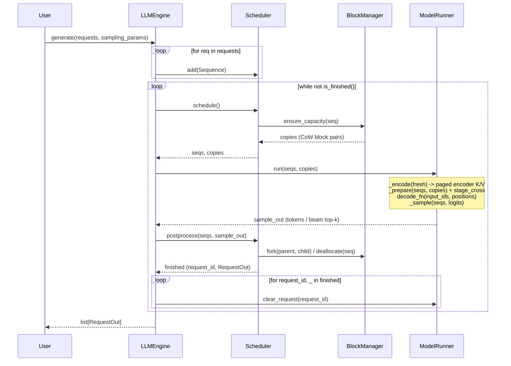

# fast-encdec

A small, readable CPU inference engine for **BART** and **Florence-2**, in the spirit of
[nano-vllm](https://github.com/GeeeekExplorer/nano-vllm).

## Key Features

* **Fast offline CPU inference** - paged KV cache, continuous batching, greedy and beam search
* **Readable codebase** - minimal PyTorch + [vllm-cpu-attention](https://github.com/ducviet00/vllm-cpu-attention) kernels
* **Two models, one engine** - BART for summarisation, Florence-2 for vision-language tasks
* **FP32 and BF16** - frozen `torch.compile` weight packing (oneDNN / ACL) + SIMD/AMX paged attention

## Installation

```bash
uv pip install torch torchvision setuptools --index-url https://download.pytorch.org/whl/cpu
uv pip install --no-build-isolation git+https://github.com/ducviet00/vllm-cpu-attention.git
uv pip install --no-build-isolation -e .
```

**On x86, use tcmalloc.** glibc malloc hands large freed buffers back to the OS, so every
Florence-2 vision forward page-faults them in again. On Xeon (c4-standard-8) tcmalloc makes
the vision stage ~1.9x faster and end-to-end throughput ~10% higher; on Axion (aarch64) it
makes no measurable difference.

```bash
sudo apt-get install -y libgoogle-perftools4t64   # older Ubuntu/Debian: libgoogle-perftools4
export LD_PRELOAD=/usr/lib/x86_64-linux-gnu/libtcmalloc.so.4
```

## Quick Start

See `examples/` for runnable scripts. `LLM` takes `dtype` (`torch.float32` or `torch.bfloat16`),
`max_num_seqs`, `compile` (default `True`) and `mm_cache_size`:

```python
from transformers import AutoTokenizer

from fastencdec import LLM, Request, SamplingParams

tokenizer = AutoTokenizer.from_pretrained("facebook/bart-large-cnn")
llm = LLM("facebook/bart-large-cnn")
request = Request(tokenizer("A car is parked in front of a building ...")["input_ids"])
outputs = llm.generate(request, SamplingParams(max_tokens=64, num_beams=4))
print(tokenizer.decode(outputs[0].completion_token_ids, skip_special_tokens=True))
```

Florence-2 takes an image plus a task prompt, and the answer is parsed with the
processor:

```python
import torch
from PIL import Image
from transformers import AutoProcessor

from fastencdec import LLM, Request, SamplingParams

processor = AutoProcessor.from_pretrained("florence-community/Florence-2-base")
llm = LLM("florence-community/Florence-2-base", dtype=torch.bfloat16)
image = Image.open("car.jpg")
inputs = processor(text="<OD>", images=image, return_tensors="pt")
outputs = llm.generate(
    Request(inputs["input_ids"][0].tolist(), inputs["pixel_values"][0]),
    SamplingParams(max_tokens=256, num_beams=3),
)
text = processor.tokenizer.decode(outputs[0].completion_token_ids)
parsed = processor.post_process_generation(text, task="<OD>", image_size=image.size)
```

## How It Works

Reading order: `engine/sequence.py` -> `engine/block_manager.py` ->
`engine/scheduler.py` -> `engine/model_runner.py` -> `engine/llm_engine.py` ->
`layers/attention.py` -> `models/bart.py`. The step-by-step flow is in
[AGENTS.md section 4](AGENTS.md#4-how-a-step-works).



* **Paged KV cache.** Keys and values live in fixed blocks; beams share blocks and
  only copy one when they write into a shared block.
* **Continuous batching.** Requests join and leave the running batch freely.
* **No padding.** One token per sequence per step, and attention reads exactly the
  cached length of each sequence, so mixed lengths waste nothing.
* **Beam search** runs on the same cache, ranked by length-penalised score.
* **CPU attention.** Decoder self- and cross-attention call `vllm-cpu-attention`
  (`vllm_cpu_attn`) through opaque `torch.library.custom_op`s so the decoder,
  LM head, and encoder compile cleanly with Inductor weight freezing.

## Benchmark

Measured on GCP `c4a-standard-8` (Arm Neoverse-V2, 8 physical cores) and
`c4-standard-8` (Intel Xeon 8581C, **4** physical cores, AMX) with
`torch 2.15.0+cpu`, `transformers 5.22.2` and `vllm-cpu-attn 0.1.0`, bf16.
Both backends on the Xeon box run with tcmalloc (`LD_PRELOAD`, see Installation).
Wall times are not like-for-like across the two machines: the Xeon box has
half the physical cores. Cells are fast-encdec / HF (speedup).

**Continuous batching** (`benchmarks/continuous_batching.py`): 32 Florence-2-base
requests (8 COCO images x `<OD>`, `<OCR>`, `<DETAILED_CAPTION>`,
`<REFERRING_EXPRESSION_SEGMENTATION>`), 8 requests in flight, up to 512 tokens.
fast-encdec refills a slot as soon as a request finishes, and its multimodal cache
(on by default, cleared before each run) runs the vision encoder once per image:
8 misses, 24 hits. HF runs 4 padded batches of 8 and encodes every image, and
68-75% of its decoded positions are padding. One timed run after 3 warmup runs;
cells are wall time and generated tokens/s, speedup over HF is by wall time.

<table>
<tr><th>config</th><th>engine</th><th align="right">c4a-standard-8</th><th align="right">c4-standard-8</th></tr>
<tr><td rowspan="2">greedy</td><td>fast-encdec</td><td align="right">7.8 s, 471 tok/s (<b>4.27x</b>)</td><td align="right">7.1 s, 509 tok/s (<b>5.13x</b>)</td></tr>
<tr><td>HF</td><td align="right">33.1 s, 110 tok/s</td><td align="right">36.3 s, 104 tok/s</td></tr>
<tr><td rowspan="2">beams=4</td><td>fast-encdec</td><td align="right">13.9 s, 375 tok/s (<b>5.12x</b>)</td><td align="right">13.4 s, 389 tok/s (<b>9.21x</b>)</td></tr>
<tr><td>HF</td><td align="right">70.9 s, 73 tok/s</td><td align="right">123.7 s, 40 tok/s</td></tr>
</table>

**Per stage** (`benchmarks/stage_latency.py`): batch 8; Florence-2-base with
`<DETAILED_CAPTION>` (590 encoder tokens), BART-large-cnn with 512 encoder tokens.
The multimodal cache is off here so the vision stage runs every call.
The decode step is averaged over 128 steps with EOS suppressed.

| stage | c4a-standard-8 | c4-standard-8 |
|---|---:|---:|
| Florence-2 vision | 2214 / 2218 ms (1.00x) | 1451 / 2576 ms (1.78x) |
| Florence-2 encode | 269 / 272 ms (1.01x) | 156 / 173 ms (1.11x) |
| Florence-2 decode step, greedy | 6.32 / 11.57 ms (1.83x) | 7.39 / 12.85 ms (1.74x) |
| Florence-2 decode step, beams=4 | 13.62 / 25.27 ms (1.86x) | 13.39 / 43.79 ms (3.27x) |
| BART encode | 715 / 715 ms (1.00x) | 374 / 420 ms (1.12x) |
| BART decode step, greedy | 13.42 / 24.57 ms (1.83x) | 17.91 / 28.15 ms (1.57x) |
| BART decode step, beams=4 | 27.48 / 54.51 ms (1.98x) | 30.78 / 92.25 ms (3.00x) |

## Tests & Benchmarks

```bash
PYTHONPATH=. python tests/test_parity.py            # vs transformers, tiny random BART
PYTHONPATH=. python tests/test_florence2.py         # vs transformers, tiny random Florence-2
PYTHONPATH=. python tests/test_beam.py              # beam candidate selection
PYTHONPATH=. python tests/test_logits_processor.py  # LogitsProcessor parity vs transformers
PYTHONPATH=. python tests/test_engine.py            # lifetime, cache budgets, validation, loading
PYTHONPATH=. python tests/test_benchmarks.py        # benchmark helpers
PYTHONPATH=. python tests/verify_parity.py          # real checkpoints (BART + Florence-2)

# one backend per run; run with --backend fast and --backend hf and compare
PYTHONPATH=. python benchmarks/stage_latency.py --backend fast         # Florence-2: vision / encode / decode-step ms
PYTHONPATH=. python benchmarks/stage_latency.py --backend fast --model facebook/bart-large-cnn
PYTHONPATH=. python benchmarks/continuous_batching.py --backend fast   # 32 mixed Florence-2 requests, 8 in flight (hf: padded batches of 8)
```
