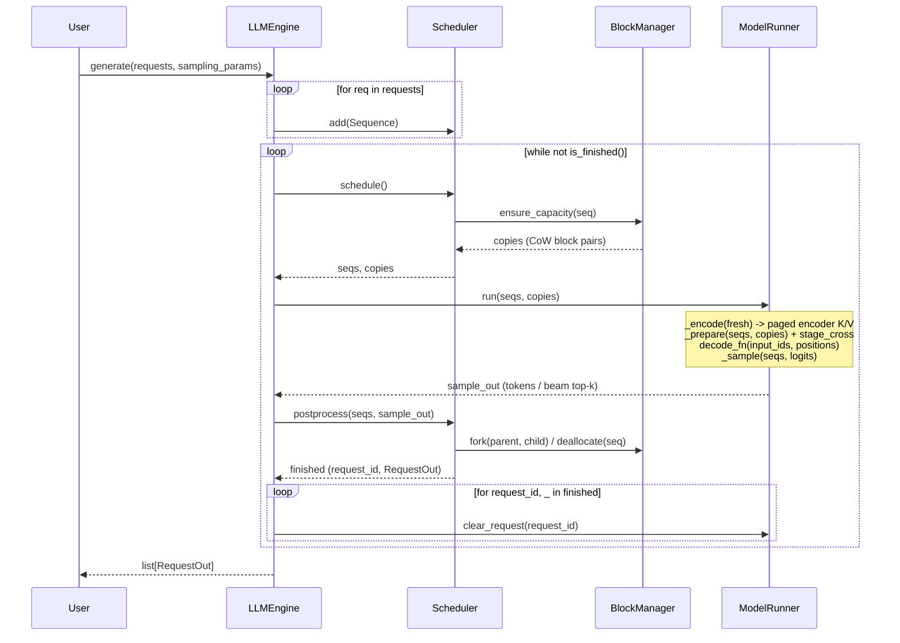

# fast-encdec

A small, readable CPU inference engine for **BART** and **Florence-2**, in the spirit of
[nano-vllm](https://github.com/GeeeekExplorer/nano-vllm).

## Key Features

* **Fast offline CPU inference** - paged KV cache, continuous batching, greedy and beam search
* **Readable codebase** - minimal PyTorch + [vllm-cpu-attention](https://github.com/ducviet00/vllm-cpu-attention) kernels
* **Two models, one engine** - BART for summarisation, Florence-2 for vision-language tasks
* **FP32 and BF16** - frozen `torch.compile` weight packing (oneDNN / ACL) + SIMD/AMX paged attention

## Installation

```bash
uv pip install torch torchvision setuptools --index-url https://download.pytorch.org/whl/cpu
uv pip install --no-build-isolation git+https://github.com/ducviet00/vllm-cpu-attention.git
uv pip install --no-build-isolation -e .
```

**On x86, use tcmalloc.** glibc malloc hands large freed buffers back to the OS, so every
Florence-2 vision forward page-faults them in again. On Xeon (c4-standard-8) tcmalloc makes
the vision stage ~1.9x faster and end-to-end throughput ~10% higher; on Axion (aarch64) it
makes no measurable difference.

```bash
sudo apt-get install -y libgoogle-perftools4t64   # older Ubuntu/Debian: libgoogle-perftools4
export LD_PRELOAD=/usr/lib/x86_64-linux-gnu/libtcmalloc.so.4
```

## Quick Start

See `examples/` for runnable scripts. `LLM` takes `dtype` (`torch.float32` or `torch.bfloat16`),
`max_num_seqs`, `compile` (default `True`) and `mm_cache_size`:

```python
from transformers import AutoTokenizer

from fastencdec import LLM, Request, SamplingParams

tokenizer = AutoTokenizer.from_pretrained("facebook/bart-large-cnn")
llm = LLM("facebook/bart-large-cnn")
request = Request(tokenizer("A car is parked in front of a building ...")["input_ids"])
outputs = llm.generate(request, SamplingParams(max_tokens=64, num_beams=4))
print(tokenizer.decode(outputs[0].completion_token_ids, skip_special_tokens=True))
```

`SamplingParams` fields you leave unset take the checkpoint's
`generation_config.json` values (beams, `no_repeat_ngram_size`, length penalty, ...),
as in `transformers`; set only what you want to override.

Florence-2 takes an image plus a task prompt, and the answer is parsed with the
processor:

```python
import torch
from PIL import Image
from transformers import AutoProcessor

from fastencdec import LLM, Request, SamplingParams

processor = AutoProcessor.from_pretrained("florence-community/Florence-2-base")
llm = LLM("florence-community/Florence-2-base", dtype=torch.bfloat16)
image = Image.open("car.jpg")
inputs = processor(text="<OD>", images=image, return_tensors="pt")
outputs = llm.generate(
    Request(inputs["input_ids"][0].tolist(), inputs["pixel_values"][0]),
    SamplingParams(max_tokens=256, num_beams=3),
)
text = processor.tokenizer.decode(outputs[0].completion_token_ids)
parsed = processor.post_process_generation(text, task="<OD>", image_size=image.size)
```

## How It Works

Reading order: `engine/sequence.py` -> `engine/block_manager.py` ->
`engine/scheduler.py` -> `engine/model_runner.py` -> `engine/llm_engine.py` ->
`layers/attention.py` -> `models/bart.py`. The step-by-step flow is in
[AGENTS.md section 4](AGENTS.md#4-how-a-step-works).



* **Paged KV cache.** Keys and values live in fixed blocks; beams share blocks and
  only copy one when they write into a shared block.
* **Continuous batching.** Requests join and leave the running batch freely.
* **No padding.** One token per sequence per step, and attention reads exactly the
  cached length of each sequence, so mixed lengths waste nothing.
* **Beam search** runs on the same cache, ranked by length-penalised score.
* **CPU attention.** Decoder self- and cross-attention call `vllm-cpu-attention`
  (`vllm_cpu_attn`) through opaque `torch.library.custom_op`s so the decoder,
  LM head, and encoder compile cleanly with Inductor weight freezing.

## Benchmark

Measured on GCP `c4a-standard-8` / `c4a-standard-16` (Arm Neoverse-V2, 8 / 16
physical cores) and `c4-standard-8` / `c4-standard-16` (Intel Xeon 8581C,
**4 / 8** physical cores, AMX) with `torch 2.15.0+cpu`, `transformers 5.22.2` and
`vllm-cpu-attn 0.1.0`, bf16. Both backends on the Xeon boxes run with tcmalloc
(`LD_PRELOAD`, see Installation). Wall times are not like-for-like across Arm and
x86: at the same vCPU count the Xeon box has half the physical cores.

**Continuous batching** (`benchmarks/continuous_batching.py`): 128 Florence-2
requests (32 COCO images x `<OD>`, `<CAPTION>`, `<DETAILED_CAPTION>`,
`<REFERRING_EXPRESSION_SEGMENTATION>`, shuffled), up to 512 tokens each, with the
checkpoint's generation config (`no_repeat_ngram_size=3`, ...) on both backends.
fast-encdec keeps `--max-num-req` requests in flight and refills a slot as soon as a
request finishes; its multimodal cache (on by default, cleared before each run)
runs the vision encoder once per image: 32 misses, 96 hits. HF runs padded batches
of the same size and encodes every image; 68-81% of its decoded positions are
padding. Cells are fast-encdec / HF wall time (**speedup**), median of 3 timed runs
after 1 warmup. With beam search every request runs as 4 sequences, so 64 requests
with beams=4 decode 256 sequences per step. HF OOM: killed by the kernel on the
30 GB `c4-standard-8`.

Florence-2-base, greedy:

| max num req | c4a-standard-8 | c4-standard-8 | c4a-standard-16 | c4-standard-16 |
|---|---:|---:|---:|---:|
| 8 | 27.4 s / 113.6 s (**4.14x**) | 26.2 s / 128.8 s (**4.91x**) | 20.7 s / 90.9 s (**4.39x**) | 15.2 s / 69.5 s (**4.57x**) |
| 16 | 25.0 s / 97.5 s (**3.89x**) | 21.9 s / 113.4 s (**5.17x**) | 17.7 s / 73.6 s (**4.15x**) | 12.5 s / 65.8 s (**5.27x**) |
| 32 | 22.7 s / 89.8 s (**3.95x**) | 20.1 s / 117.0 s (**5.81x**) | 15.5 s / 63.2 s (**4.07x**) | 10.9 s / 69.6 s (**6.37x**) |
| 64 | 23.2 s / 78.9 s (**3.40x**) | 19.3 s / 108.4 s (**5.63x**) | 15.3 s / 50.5 s (**3.30x**) | 10.3 s / 62.1 s (**6.02x**) |

Florence-2-base, beams=4:

| max num req | c4a-standard-8 | c4-standard-8 | c4a-standard-16 | c4-standard-16 |
|---|---:|---:|---:|---:|
| 8 | 41.6 s / 226.6 s (**5.45x**) | 37.0 s / 357.8 s (**9.66x**) | 31.2 s / 190.2 s (**6.09x**) | 21.3 s / 230.4 s (**10.80x**) |
| 16 | 35.9 s / 207.2 s (**5.76x**) | 32.3 s / 386.6 s (**11.95x**) | 25.0 s / 166.9 s (**6.68x**) | 18.3 s / 237.2 s (**12.93x**) |
| 32 | 33.5 s / 219.0 s (**6.54x**) | 30.3 s / 441.9 s (**14.57x**) | 22.8 s / 174.1 s (**7.64x**) | 17.2 s / 278.6 s (**16.23x**) |
| 64 | 32.5 s / 195.6 s (**6.01x**) | 29.2 s / 435.4 s (**14.93x**) | 21.5 s / 138.7 s (**6.44x**) | 16.4 s / 260.6 s (**15.91x**) |

Florence-2-large, greedy:

| max num req | c4a-standard-8 | c4-standard-8 | c4a-standard-16 | c4-standard-16 |
|---|---:|---:|---:|---:|
| 8 | 72.1 s / 292.8 s (**4.06x**) | 64.1 s / 276.4 s (**4.31x**) | 48.0 s / 195.5 s (**4.08x**) | 34.5 s / 151.5 s (**4.40x**) |
| 16 | 69.2 s / 285.0 s (**4.12x**) | 55.0 s / 261.8 s (**4.76x**) | 41.6 s / 169.3 s (**4.07x**) | 28.7 s / 139.8 s (**4.87x**) |
| 32 | 67.9 s / 267.6 s (**3.94x**) | 50.4 s / 270.3 s (**5.36x**) | 38.6 s / 148.4 s (**3.84x**) | 26.2 s / 143.2 s (**5.47x**) |
| 64 | 69.5 s / 250.5 s (**3.61x**) | 48.5 s / HF OOM | 38.1 s / 129.9 s (**3.41x**) | 24.7 s / 135.1 s (**5.46x**) |

Florence-2-large, beams=4:

| max num req | c4a-standard-8 | c4-standard-8 | c4a-standard-16 | c4-standard-16 |
|---|---:|---:|---:|---:|
| 8 | 107.2 s / 488.1 s (**4.55x**) | 84.5 s / 746.8 s (**8.84x**) | 63.9 s / 354.9 s (**5.56x**) | 48.0 s / 468.6 s (**9.77x**) |
| 16 | 93.9 s / 499.5 s (**5.32x**) | 76.9 s / 842.8 s (**10.96x**) | 54.8 s / 336.3 s (**6.14x**) | 41.5 s / 514.8 s (**12.39x**) |
| 32 | 87.0 s / 558.9 s (**6.42x**) | 73.1 s / 1038.1 s (**14.20x**) | 51.5 s / 352.0 s (**6.83x**) | 39.2 s / 620.9 s (**15.83x**) |
| 64 | 85.6 s / 532.6 s (**6.22x**) | 73.1 s / HF OOM | 50.6 s / 341.9 s (**6.76x**) | 36.9 s / 629.1 s (**17.05x**) |

**Per stage** (`benchmarks/stage_latency.py`): batch 8; Florence-2-base with
`<DETAILED_CAPTION>` (590 encoder tokens), BART-large-cnn with 512 encoder tokens.
The multimodal cache is off here so the vision stage runs every call.
The decode step is averaged over 128 steps with EOS suppressed; each number is the
median of 3 timed runs after 1 warmup. Cells are fast-encdec / HF (speedup).

| stage | c4a-standard-8 | c4-standard-8 | c4a-standard-16 | c4-standard-16 |
|---|---:|---:|---:|---:|
| Florence-2 vision | 2240 / 2412 ms (1.08x) | 1505 / 2582 ms (1.72x) | 1166 / 1176 ms (1.01x) | 703 / 1348 ms (1.92x) |
| Florence-2 encode | 268 / 280 ms (1.04x) | 160 / 185 ms (1.15x) | 144 / 145 ms (1.01x) | 81.1 / 90.1 ms (1.11x) |
| Florence-2 decode step, greedy | 6.79 / 11.64 ms (1.71x) | 7.69 / 13.14 ms (1.71x) | 6.16 / 9.93 ms (1.61x) | 4.52 / 7.31 ms (1.62x) |
| Florence-2 decode step, beams=4 | 13.0 / 25.3 ms (1.95x) | 13.4 / 45.4 ms (3.37x) | 11.6 / 22.0 ms (1.90x) | 7.36 / 28.45 ms (3.87x) |
| BART encode | 731 / 745 ms (1.02x) | 379 / 422 ms (1.11x) | 375 / 376 ms (1.00x) | 192 / 217 ms (1.13x) |
| BART decode step, greedy | 13.4 / 25.2 ms (1.88x) | 18.9 / 28.5 ms (1.50x) | 11.4 / 20.9 ms (1.83x) | 9.88 / 16.18 ms (1.64x) |
| BART decode step, beams=4 | 28.0 / 54.6 ms (1.95x) | 31.4 / 91.0 ms (2.90x) | 19.6 / 45.0 ms (2.30x) | 17.5 / 58.5 ms (3.34x) |

## Tests & Benchmarks

```bash
PYTHONPATH=. python tests/test_parity.py            # vs transformers, tiny random BART
PYTHONPATH=. python tests/test_florence2.py         # vs transformers, tiny random Florence-2
PYTHONPATH=. python tests/test_beam.py              # beam candidate selection
PYTHONPATH=. python tests/test_logits_processor.py  # LogitsProcessor parity vs transformers
PYTHONPATH=. python tests/test_engine.py            # lifetime, cache budgets, validation, loading
PYTHONPATH=. python tests/test_benchmarks.py        # benchmark helpers
PYTHONPATH=. python tests/verify_parity.py          # real checkpoints (BART + Florence-2)

# one backend per run; run with --backend fast and --backend hf and compare
PYTHONPATH=. python benchmarks/stage_latency.py --backend fast         # Florence-2: vision / encode / decode-step ms
PYTHONPATH=. python benchmarks/stage_latency.py --backend fast --model facebook/bart-large-cnn
PYTHONPATH=. python benchmarks/continuous_batching.py --backend fast   # 128 mixed Florence-2 requests, 8 in flight (hf: padded batches of 8)
```
